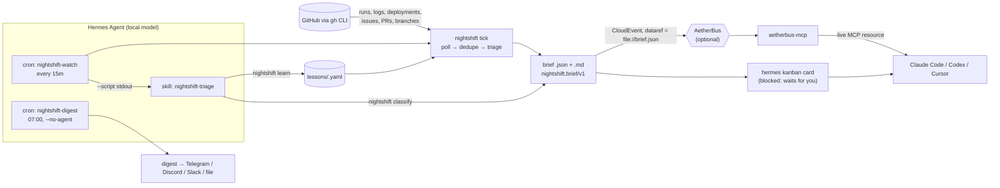

# Hermes Nightshift

> A night shift for your GitHub repos. A cheap local model on [Hermes Agent](https://github.com/NousResearch/hermes-agent) watches CI, deployments, issues and PRs, triages failures, and writes a fixed-schema **brief** per incident. Stronger coding agents (Claude Code, Codex, Cursor) pick up the brief and do the fix, starting from finished homework instead of a red badge.

[](.github/workflows/ci.yml) [](LICENSE)

The split is deliberate. Watching, reproducing and remembering happen many times a night and must be cheap, so they run as deterministic Python plus a small local model (the default target is a Qwen 35B-A3B on llama.cpp). Expensive models run only for the fix, and they start from a brief that already has the failing log, a repro command, the culprit commit range and the repo's known gotchas.

## Architecture



1. **Watch.** A Hermes cron job runs `nightshift tick` every 15 minutes. It polls with `gh` for failed Actions runs, failed deployments (Vercel and most hosts report through GitHub deployment statuses, so no Vercel token is needed), new issues, PRs awaiting review and stale branches. Polling means no public webhook. The detectors are pure functions over `gh` JSON, so a `hermes webhook` route can feed them later (see [docs/webhooks.md](docs/webhooks.md)).
2. **Triage.** For each new failure, Nightshift pulls the failing step's log. It extracts the error, the failing test and the step's command, then finds the last green and first red runs and diffs them for the culprit commits and suspected files. It also classifies the failure as flaky, real or infra with a heuristic. A red streak becomes one incident, not one per run.
3. **Brief.** It writes one brief per incident to disk as JSON, the canonical copy validated against [a versioned JSON Schema](src/nightshift/schema/brief.v1.schema.json), plus a Markdown rendering. See [docs/brief-schema.md](docs/brief-schema.md).
4. **Handoff.** It opens a Hermes kanban card with the brief attached, `blocked` by default so no Hermes worker picks it up on its own and, if enabled, publishes a CloudEvent to [AetherBus](https://github.com/ShazebA/aetherbus) whose `dataref` points at the brief JSON (a pointer, not a payload). `aetherbus-mcp` exposes the topic as a live MCP resource, so an MCP client sees new briefs as they land. Each sink is optional, and a sink failure never loses the brief.
5. **Learn.** The cron prompt wakes the model only when there is a new failure. The `nightshift-triage` skill has the model confirm or override the heuristic (`nightshift classify`) and record repo-specific lessons (`nightshift learn`). Lessons are regexes matched against future failing logs, so the next brief already says, for example, "this repo's CI fails when Supabase migrations aren't applied".
6. **Digest.** A morning `--no-agent` cron job summarizes the night to whatever gateway Hermes has configured, and also writes it to a file.

### Why a CLI + skill and not a plugin or MCP server

Hermes's `AGENTS.md` ranks how new capability should be added: extend existing code, then CLI command + skill, then a service-gated tool, plugin, MCP server, and core tool last. Nightshift is the **CLI + skill** rung, wired in with **cron `--script` jobs**:

- Everything except the classification judgement is deterministic. It is a CLI (`nightshift`), not model tools, so it costs zero schema tokens per API call and is testable without a model.
- Hermes cron already has the right primitive. A pre-run `--script` whose stdout is injected into the prompt, plus the `{"wakeAgent": false}` gate, means the model is not called at all on a quiet night.
- The skill carries the narrow procedure the small model follows, and it passes Hermes's own skill linter.
- Kanban is driven through the public `hermes kanban` CLI rather than imports from the Hermes tree, so Nightshift survives Hermes refactors. It needs no plugin and makes no core changes.
- The MCP surface already exists in `aetherbus-mcp`, so Nightshift does not ship another MCP server.

More detail: [docs/design.md](docs/design.md).

## Quickstart

You need Python 3.11+, [`gh`](https://cli.github.com) logged in (`gh auth login`), and optionally [Hermes Agent](https://github.com/NousResearch/hermes-agent) for the cron, skill and kanban parts.

```bash
git clone https://github.com/ShazebA/hermes-nightshift.git
cd hermes-nightshift
python -m venv .venv && source .venv/bin/activate
pip install -e ".[dev]"
pytest
```

Try it on recorded data first. This replays a red night (a real CI break, a flaky E2E run, a failed deploy) against whatever repo name is in your config, and only writes files under `./nightshift-dry-run/`:

```bash
cp config.example.yaml nightshift.yaml
nightshift poll --dry-run --fixtures tests/fixtures/red-main
cat nightshift-dry-run/your-org__your-app/ci-ci-main-9002.md
```

Point it at your repo by editing `repos[0].name` in `nightshift.yaml`, then poll live (read-only `gh` calls, still a dry run):

```bash
nightshift doctor
nightshift poll --dry-run
```

Drop `--dry-run` to record state, open kanban cards and publish events. Each incident is handled once; later polls skip it.

### Run it every night with Hermes

```bash
mkdir -p ~/.config/nightshift && cp nightshift.yaml ~/.config/nightshift/nightshift.yaml
scripts/install-hermes.sh            # shows what it would copy into ~/.hermes; changes nothing
scripts/install-hermes.sh --apply    # copies the skill and the two cron scripts
```

The installer prints the `hermes cron create` commands for the watch and digest jobs, and never runs them for you. Use `DELIVER=telegram scripts/install-hermes.sh` to print a digest command that targets a gateway platform. Cron jobs need the Hermes gateway running (`hermes gateway install`).

### Optional: AetherBus

```bash
pip install -e "/path/to/aetherbus"        # or: pip install 'hermes-nightshift[aetherbus]'
(cd /path/to/aetherbus && docker compose up -d nats)
aetherbus-mcp serve --topic dev.aetherbus.nightshift.brief.v1
```

Set `aetherbus.enabled: true`. Add `aetherbus-mcp` to your coding agent's `.mcp.json` with the same `--topic`, and `aetherbus://dev.aetherbus.nightshift.brief.v1` resolves to the newest brief. If the broker is down, events are marked `pending` and retried on the next poll. Nightshift never reports an event as published when it is only sitting in a local outbox.

## Commands

| Command | What it does |
|---|---|
| `nightshift poll [--dry-run] [--fixtures DIR] [--json]` | One pass: detect, triage, write briefs, hand off |
| `nightshift tick` | `poll` formatted for a Hermes cron `--script` (ends with `{"wakeAgent": false}` when quiet) |
| `nightshift classify ID --category C --confidence X --rationale R` | Record a model or human classification; keeps the heuristic alongside |
| `nightshift learn OWNER/REPO --pattern RE --note TEXT` | Save a lesson that future briefs match against failing logs |
| `nightshift lessons OWNER/REPO` | List config and learned lessons |
| `nightshift repro ID [--execute]` | Re-run the brief's repro in a throwaway Docker container (opt-in) |
| `nightshift digest [--hours N]` | Summarize everything since the last digest |
| `nightshift brief show ID` / `brief validate FILE` | Print or validate a brief |
| `nightshift doctor` | Check `gh`, `hermes`, AetherBus and Docker |

## Config reference

The config lives at `./nightshift.yaml`, then `$NIGHTSHIFT_CONFIG`, then `~/.config/nightshift/nightshift.yaml`, or wherever `-c PATH` points. See [config.example.yaml](config.example.yaml).

| Key | Default | Meaning |
|---|---|---|
| `state_dir` | `~/.local/share/nightshift` | State, ledger, lessons, digests |
| `briefs_dir` | `<state_dir>/briefs` | Briefs, as `<owner>__<repo>/<id>.{json,md}` |
| `lookback_runs` | `30` | Runs per branch scanned to find last green |
| `repos[].name` | required | `owner/repo` |
| `repos[].branches` | `[main]` | Branches whose CI is watched; never reported stale |
| `repos[].watch` | all | Any of `ci, deployments, issues, pull_requests, stale_branches` |
| `repos[].path` | none | Local clone used by `repro` (otherwise cloned from GitHub) |
| `repos[].repro_setup` | none | Prepended to repro commands, for example `npm ci` |
| `repos[].build_command` | none | Repro command for failed deployments |
| `repos[].stale_branch_days` | `30` | Idle age that makes a branch stale |
| `repos[].lessons[]` | `[]` | `{pattern, note}` static hints |
| `repos[].sandbox_image` | `sandbox.image` | Per-repo image |
| `kanban.enabled` | `true` | Create a card per failure brief |
| `kanban.board` | current board | `hermes kanban --board` |
| `kanban.status` | `blocked` | `blocked` waits for a human. `triage` cards are auto-decomposed and dispatched by a running Hermes gateway. `ready` is dispatched once an assignee or `kanban.default_assignee` is set |
| `kanban.assignee` | none | Hermes profile to assign |
| `kanban.hermes_bin` | `hermes` | Path to the Hermes CLI |
| `aetherbus.enabled` | `false` | Publish a CloudEvent per brief |
| `aetherbus.url` | `nats://localhost:4222` | Broker |
| `aetherbus.topic` | `dev.aetherbus.nightshift.brief.v1` | Must sit under `aetherbus.>` or `dev.aetherbus.>` |
| `aetherbus.source` | `aetherbus://nightshift` | CloudEvents `source` |
| `sandbox.enabled` | `false` | Allow `repro --execute` |
| `sandbox.image` | `node:22-bookworm` | Container image |
| `sandbox.network` | `bridge` | Docker network (`none` blocks installs) |
| `sandbox.timeout_seconds` | `900` | Repro timeout |

## Status

This is alpha. The end-to-end slice (config → poll → triage → brief → kanban → AetherBus) is tested against recorded `gh` fixtures and the real `aetherbus` package. Live runs have covered `gh` polling, the kanban sink and Hermes's cron script runner. Not yet exercised live: the model's half of the cron job, the Docker repro and a running NATS broker. See [CONTRIBUTING.md](CONTRIBUTING.md) to help.

## License

Apache 2.0. See [LICENSE](LICENSE).
